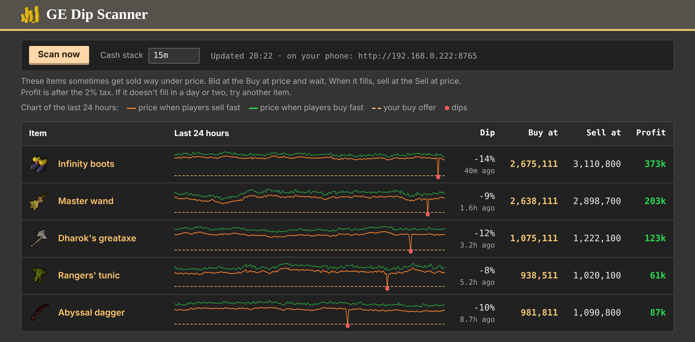
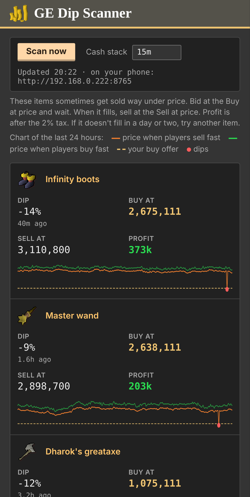

# OSRS GE Dip Scanner

Finds GE items that sometimes get sold way under price, and tells you what to bid. I made it for my
own flipping.

## How to use it

1. Bid at the Buy at price.
2. When it fills, sell at the Sell at price.
3. If it doesn't fill in a day or two, try another item.

Profit is after the 2% GE tax.

## Setup (Windows, once)

1. Install Python from [python.org](https://www.python.org/downloads/). In the installer, tick
   **Add python.exe to PATH**.
2. On this page, click the green **Code** button, then **Download ZIP**. Unzip it anywhere.
3. Double-click **GE Dip Scanner.bat**. The scanner opens in your browser.
4. Type your cash stack (for example `15m`) and click **Scan**.

From then on, just double-click **GE Dip Scanner.bat**. It updates itself each time it starts.

## On your phone

Your PC runs the scanner, and your phone can open the same page:

1. Start the scanner on your PC. If Windows asks whether to allow Python on your network, tick
   **Private networks** and click **Allow**.
2. At the top of the page on your PC it says **on your phone:** followed by an address like
   `http://192.168.0.222:8765`. Open that address on your phone while it's on the same Wi-Fi.

To use it away from home, install [Tailscale](https://tailscale.com) (free) on your PC and your
phone, sign in to both with the same account, and open `http://<your PC's name>:8765` on your phone.
Your PC has to be on with the scanner running.

## Details

- It looks at items priced between 5% and 40% of your cash stack that trade at least 25 times a
  day, and shows the 10 with the most profit.
- While the page is open it checks again every 10 minutes.
- To stop it, close the small **GE Dip Scanner** window. It also stops by itself 12 hours after
  you close the page.
- Prices come from the [OSRS Wiki's real-time prices](https://prices.runescape.wiki).

<b>How the numbers are worked out</b>

- **Dip**: a price at least 5% below both the price around it and the item's 7-day average, that
  lasted 30 minutes or less and bounced back within an hour. Only dips from the last 18 hours count.
  The Dip column shows how far below normal the latest dip went, and how long ago it was.
- **Buy at**: 1% above the low of the latest dip. That dip used up the buy offer someone had at
  that price, so an offer just above it is first in line for the next dump. Prices end in 111
  (1,004,111) to sit just above other players' round-number offers.
- **Sell at**: 0.5% under what buyers have been paying over the last hour, and never more than they
  usually paid over the last 7 days.
- An item only shows up if its profit is at least 2%.
- If there aren't 10 good items in your price range, it also looks at the next cheaper range
  (items up to 10 times cheaper), and then the one below that.

<b>Settings</b>

Your cash stack is set on the page. For anything else, create a file called `config.json` next to
the scanner, for example `{"max_shown": 10}`. Updates never change it.

| Setting | Default | What it does |
| --- | --- | --- |
| `max_shown` | 10 | How many items to show. |
| `beat_by_pct` | 1 | How far above the dip's low the Buy at price is, in %. |
| `min_profit_pct` | 2 | The least profit to show, in % after tax. |
| `undercut_pct` | 0.5 | How far under recent buyers the Sell at price is, in %. |
| `max_auto_items` | 75 | How many of the busiest items to check in your price range. |
| `min_daily_volume` | 25 | Trades a day an item needs to be checked at all. |
| `min_item_pct` / `max_offer_pct` | 5 / 40 | Cheapest and priciest items to check, as % of your stack. |

To always check certain items, add their names to `watchlist.txt` (spelled as on the prices site).

<b>Dip log</b>

Every scan writes each dip to `dip_log.csv` next to the scanner, so you can check later how well
the Buy at prices would have filled. Each line is written 6 hours after the dip, with the lowest
price in those 6 hours (`next_low`). Nothing on the page uses it yet. Open it in any spreadsheet app.

